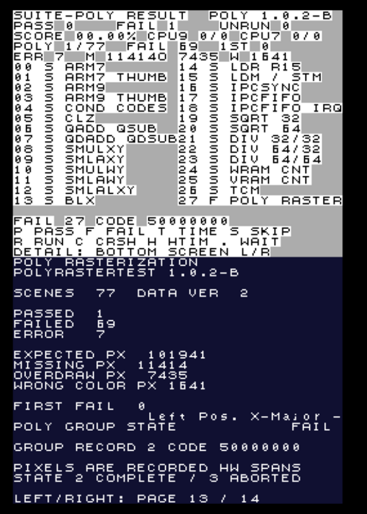

# Polygon rasterization group (suite-poly.nds)

This folder is self-contained: `Src/`, the `Makefile` and the built
`suite-poly.nds` all live here, nothing outside it is needed to build or flash
the ROM. It is the `suite-nds-minimal` test suite with an automated polygon
rasterization accuracy group ported from
[Jaklyy/polyrastertest](https://github.com/Jaklyy/polyrastertest) compiled in.

```
make            # build suite-poly.nds (the only ROM this folder produces)
make selftest   # host-side verification of the comparison engine
make disasm     # objdump listings alongside the ROM
make clean

make DEVKITARM=/usr DEVKITPRO=/home/user     # Debian toolchain, ndstool on PATH
make DEVKITPRO=/opt/devkitpro                # default devkitPro layout
```

The prebuilt `suite-poly.nds` in this folder is byte-identical to what `make`
produces from this tree (`sha256 29d434d9…2b9f`).

### Relationship to suite-nds-minimal

Nothing in `suite-nds-minimal` changed. The polygon group reuses its sources
(`Src/` here is a copy) with the new group behind `#ifdef SUITE_POLY`; a build
of that folder without the define still produces its documented
`da6ab434…13bf` image. Use this folder for the merged ROM, and the original
folder if you only want the CPU groups.

## What runs

`suite-poly.nds` is one list of 28 groups: the 27 original CPU/system groups
(0–26) plus **POLY RASTER** as group 27. Selecting group 27 runs all 77
recorded scenes; group 27 is reported as pass only if every scene matches the
hardware recording pixel for pixel.

## Why the vendored test table is v1.0.2-b, not upstream `main`

Upstream `main` has 100 scenes but its `data/rastertest.data` was last recorded
for the 77-scene table of tag **v1.0.2-b**. Decoding the shipped data file with
`main`'s table desynchronises partway through (scenes 37–47 were rewritten and
11 scenes were appended without a re-record), and upstream `main`'s own ROM
therefore cannot pass its own data for those scenes either. This port vendors
`source/main.h` verbatim from v1.0.2-b, which decodes cleanly and exactly
consumes all 43,664 recorded bytes:

* 77 scenes
* 102,942 recorded pixels
* data version 2

The test table (`Src/src9/poly/poly_model.h`) and the bitstream
(`Src/src9/poly/rastertest.data`) are both unmodified upstream files. Local
changes are limited to `poly_compat.h`, which replaces libnds with bare-metal
register definitions.

## How a scene is measured

Exactly like upstream:

1. Reset the 3D state the way `glInit()` does (power on the 3D core and matrix
   unit, clear the FIFO, reset the matrix stack, rear plane black/alpha 31).
2. Load the scene's projection matrix, viewport, polygon attributes, rear
   plane and outline colours, submit the polygon(s), flush.
3. Display capture (DISPCAPCNT mode A, source = 3D only, 256×192) writes the
   rendered frame into VRAM bank A.
4. Compare every pixel against the recorded spans:
   * recorded span, hardware void → **missing** (drawn red by upstream's scheme)
   * outside span, hardware lit → **overdraw** (pink)
   * span with colour data and a different colour → **wrong colour** (blue)
   * span, hardware lit, colour matches → **match** (green)

A scene passes only with zero missing, zero overdraw and zero wrong-colour
pixels. The comparison itself runs on the ARM9, so a failing emulator or a
different NDS model produces a normal failure report rather than a crash.

## Machine-readable results

Fixed block at `0x023F0400`: 20-word header + 77 records × 12 words.

Header (word index)

| # | field |
|---|-------|
| 0 | magic `0x504C5935` ("PLY5") |
| 1 | structure version (`1`) |
| 2 | scene count (`77`) |
| 3 | recorded data version (`2`) |
| 4 | upstream tag (`0x31303242` = "102B") |
| 5 | state: 0 not run, 1 running, 2 complete, 3 aborted |
| 6 | passed scenes |
| 7 | failed scenes |
| 8 | errored scenes (no comparable capture) |
| 9 | expected pixels |
| 10 | missing pixels |
| 11 | overdraw pixels |
| 12 | wrong-colour pixels |
| 13 | first failing scene, `0xFFFFFFFF` if none |
| 14 | last scene that produced a result |
| 15 | flags: bit0 3D engine unavailable, bit1 partial run |
| 16 | checksum over all record words |
| 17–19 | reserved (zero) |

Record (base + `0x50` + `scene * 48` bytes)

| word | field |
|------|-------|
| 0 | scene id |
| 1 | state: 0 pending, 1 pass, 2 fail, 3 error |
| 2 | expected pixels |
| 3 | actual lit pixels |
| 4 | missing |
| 5 | overdraw |
| 6 | wrong colour |
| 7 | first mismatch: `x | y<<8 | kind<<16` (kind 0 missing, 1 overdraw, 2 wrong colour), `0xFFFFFFFF` if none |
| 8 | category index (0 fill rules primary, 1 fill rules unusual, 2 vertical right edge shift, 3 anti-aliasing, 4 edge marking, 5 clipping) |
| 9 | flags: bit0..2 colour mode 1/2/3, bit3 multispan |
| 10–11 | reserved |

The suite's existing box at `0x023F0000` gains an extension:

| word | value |
|------|-------|
| 18 | polygon result block address |
| 19 | passed scenes |
| 20 | failed scenes |
| 21 | errored scenes |
| 22 | first failing scene |
| 23 | poly block state (2 complete, 3 aborted) |
| 24 | scene count |
| 25 | block structure version |

Group 27's own record lives in the normal per-group record table
(`0x023F0100 + 27*8`): state 2 = fail, code `0x50000000 | first failing scene`.

## Human-readable results

* Upper LCD: one dashboard for the whole run.
  ```
  SUITE-POLY RESULT      POLY 1.0.2-B
  PASS 0  FAIL 1       UNRUN 0
  SCORE 00.00%  CPU9 0/0  CPU7 0/0
  POLY 1/77  FAIL 69  1ST 0
  ERR 7  M 11414  O 7435  W 1641
  00 S ARM7            14 S LDR R15
  01 S ARM7 THUMB      15 S LDM / STM
  ...
  13 S BLX             27 F POLY RASTER
  FAIL 27 CODE 50000000
  P PASS F FAIL T TIME S SKIP
  R RUN C CRSH H HTIM . WAIT
  DETAIL: BOTTOM SCREEN L/R
  ```
  Every one of the 28 groups is listed with its own result letter, next to the
  pass/fail/unrun totals, the score, the CPU9/CPU7 vector counters, the polygon
  group's passed/failed/errored scene counts plus missing/overdraw/wrong-colour
  pixel totals and first failing scene, and the failing group's code.
  Table letters use the same state order as the lower screen
  (WAIT PASS FAIL TIME SKIP RUN CRSH HTIM).
* Lower LCD page 13 (**POLY RASTERIZATION**): polygon totals, pixel counters,
  first failure, group record. Left/Right cycles all 14 pages.
* Lower LCD page 14 (**POLY FAILURES**): the first nine nonpassing scenes with
  missing/overdraw/colour counts and the first bad coordinate.

## Tooling

`tools/poly-selftest` verifies the comparison engine off-target: it compiles the
real `poly_ref.cpp` for the host, decodes the stream with an independent Python
implementation, and checks

* decoder parity (per-scene pixel counts against the Python decoder),
* exact match (a decoded reference frame passes every scene),
* overdraw, missing and wrong-colour detection at known coordinates,
* seeking back to an arbitrary scene,
* the expected-count pre-pass used for capture retry.

`make selftest` runs all of it and prints
`SELFTEST PASSED: 77 scenes, 102942 expected pixels`.

## Accuracy notes

* The recordings come from a New 3DS XL. A different NDS model may legitimately
  produce different pixels; those scenes then fail with a detailed diff instead
  of silently passing.
* DeSmuME is not bit-accurate for these scenes: upstream's own 1.0.2-b ROM also
  fails scene 0 in DeSmuME (0/1 tests passed on its own status line). A run of
  `suite-poly.nds` in DeSmuME 0.9.13 therefore reports 1 pass / 69 fail /
  7 error — the failures carry full pixel deltas, and the 7 errors are captures
  that came back blank and are reported as errors instead of false failures.
  On real hardware the same comparison is expected to come out clean; the number
  to watch is the pixel counters, not the emulator verdict.
* Scenes whose recorded spans are empty (scene 49 onwards in the v1.0.2-b data
  are degenerate/limit tests) are still executed and compared.



## Credits

polyrastertest tests, recording and error-colour scheme: Jakly (Jaklyy),
data recorded on a New 3DS XL via TWiLight Menu++ 26.3.0. See
`Src/src9/poly/LICENSE.polyrastertest` (MIT).
