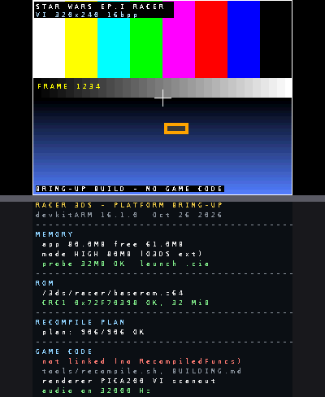

# Racer 3DS — a Nintendo 3DS build target for `sp00nznet/racer`

Star Wars Episode I: Racer is an **N64 static recompilation**: the original MIPS binary is
translated to C by N64Recomp, the N64 hardware is emulated by N64ModernRuntime
(`librecomp` + `ultramodern`), and the RDP display lists are turned into graphics API calls
by **RT64** (Direct3D 12 / Vulkan / Metal). This folder is a **3DS build target** for that
project: a `platform/3ds` tree with a devkitARM/libctru platform layer, a Makefile that
emits a `.3dsx` and an 80 MB `.cia`, and the patches the runtime needs to compile for
ARMv6K.

```
bin/racer3ds.3dsx      homebrew build, launched by hbmenu (64 MB application memory)
bin/racer3ds.cia       installable build, exheader SystemMode = 80MB (O3DS extended memory)
bin/racer3ds-64.cia    same binary, 64MB system mode - bisect build for EMM problems
bin/racer3ds.smdh      icon/metadata used by all three

platform/3ds/          the build target itself (make, make cia)
runtime-patches/       the 8 source changes N64ModernRuntime/N64Recomp need for ARMv6K,
                       plus the 43 object files that result from cross-compiling them
docs/                  what the app shows on the two screens (rendered from the same code)
```

## Read this first: what the two binaries actually do

The recompiled game code is **generated from your own ROM**, and I don't have a ROM (and
can't ship one). That splits the work into two halves, and only one of them can be built
without you:

| | Bring-up build (`bin/`, built here) | Full build (`make GAME=1`, built by you) |
|---|---|---|
| Platform layer (memory mode, VI scanout, ndsp audio, input, ROM check) | complete | complete |
| N64Recomp runtime (threads, events, messages, timers, RSP) | cross-compiles for ARMv6K — 43/43 host-neutral sources, verified | links in |
| Recompiled game functions + `aspMain` audio microcode | **not present** (comes from the ROM) | generated by N64Recomp/RSPRecomp from *your* `baserom.z64` |
| Renderer | PICA200 VI scanout only | still PICA200 VI scanout — RT64 has no 3DS backend (see below) |

So `bin/racer3ds.3dsx` and `bin/racer3ds.cia` are the real, installable artefacts of this
target: they boot on hardware, report the memory mode they were given, validate the ROM on
your SD card, and run the display/input/audio paths. They are **not** the finished game.
Two things stand between them and a playable port, both spelled out in
[`PORT-NOTES.md`](PORT-NOTES.md):

1. **RDP → PICA200 renderer.** RT64 needs D3D12/Vulkan/Metal (Plume, GPU compute, shader
   pipeline). The 3DS GPU is a fixed-function 2006-era PICA200 with no compute and 6 MB of
   VRAM; RT64 cannot be built for it. A 3DS port needs a new RDP backend that walks F3DEX2
   display lists and issues citro3d draws. `platform/3ds/source/renderer_pica.cpp` has the
   seam for exactly that (`r3ds::dl_walk()` + `PicaRenderer`).
2. **Performance.** The recompiled game expects a ~1 GHz out-of-order CPU with a vector unit
   and a GPU doing the RDP work. The 3DS has 2× 268 MHz ARM11 with VFP but **no NEON**, and
   the RSP vector unit's 16-bit SIMD path falls back to scalar emulation on such a CPU
   (`librecomp/rsp_vu.hpp` handles that, at a large speed cost). Expect single-digit
   framerates even with a renderer, on New 3DS; this is why the ROM check and the memory
   mode test come first.

None of that depends on the toolchain: **the 3DS build itself is real** — the memory-mode
split you asked for is implemented in the exheader and verified with `ctrtool`, and the
runtime genuinely compiles for ARMv6K.

## Install

1. **`.cia` (80 MB / O3DS extended memory)** — install with FBI or GodMode9, then launch it
   from the HOME menu. On an Old 3DS the console reboots into extended memory mode before
   the title starts, which is what 80 MB of application memory requires; exiting the app
   also reboots. On a New 3DS it just runs (change `SystemModeExt` in
   `platform/3ds/cia/app.rsf` to `124MB` if you want a New-3DS-only build).
2. **`.3dsx` (64 MB / regular memory)** — copy to `sdmc:/3ds/racer3ds.3dsx` and launch it
   from the Homebrew Launcher. hbmenu starts homebrew in the normal 64 MB mode; a `.3dsx`
   cannot request extended memory (that is an exheader property, and hbmenu titles have no
   exheader of their own).

Both builds print the memory mode they actually received at the top of the lower screen, so
you can verify the split on your own console.

Press **SELECT** to exit. Audio is **on** by default and the 80 MB `.cia` is the default
build; every departure from that is a key you hold while launching, never a setting you have
to find:

| Hold at launch | Effect |
|---|---|
| *(nothing)* | 80 MB title, audio on, DSP firmware validated before it is used |
| **R** | audio **off** for this boot (for a console whose DSP firmware is bad) |
| **X** | **64 MB profile** — 64 KiB command buffer and a 4 MB allocation probe, so the 80 MB title behaves like a 64 MB one. The system mode itself is an exheader property and cannot change at runtime; install `bin/racer3ds-64.cia` for a real 64 MB title. |
| **L** | **safe mode** — plain text on both screens: no citro3d/citro2d, no audio, no ROM read |

`sdmc:/3ds/racer/audio.cfg` containing `off` makes the audio opt-out permanent (delete the
file to return to the default). Every startup step is written to
`sdmc:/3ds/racer/boot.log`, flushed line by line, so a crash before the first frame is
readable on the SD card: the last line is the step that died.

Why the audio opt-out exists: all three crash dumps from your console died inside libctru's
`ndspInitialize()` DSP handshake — `ndspInit()` reads a variable count from the DSP and then
reads that many entries into a 16-entry stack array without checking it, so a DSP that
answers out of range corrupts the thread stack and the next DSP IPC kills the process. This
tree therefore ships **libctru's `ndsp` with that handshake bounded**
(`platform/3ds/thirdparty/libctru-ndsp/`, all changes marked in the source): count must be
1…16, every converted pointer is checked with `svcQueryMemory` for mapped-and-writable before
anything writes through it, the IRQ wait is 400 ms, and a component that never started fails
the init. Audio can stay on by default because a bad DSP now ends in
`off (ndspInit 0xD8805Cxx)` plus a `dsp:` trace in `boot.log` instead of an abort. See
[`TROUBLESHOOTING.md`](TROUBLESHOOTING.md) for the per-dump decode.

If the installed `.cia` still misbehaves right after the launcher switches to extended
memory mode, hold **R** (audio), then **X** (64 MB profile), then **L** (safe mode): each
step removes one subsystem, and `TROUBLESHOOTING.md` lists the `boot.log` line every fault
class stops on.

The upper screen shows the 320×240 VI output (a test pattern in
this build, the game's framebuffer in a `GAME=1` build); the lower screen shows the status
described below.



*Rendered from `platform/3ds/source/vi.cpp` and `status.cpp` — the same code the console
runs — by `platform/3ds/tools/preview`.*

### ROM

Put the USA 32 MiB dump at:

```
sdmc:/3ds/racer/baserom.z64
```

The app checks it like the PC `make verify`: size 32 MiB and CRC1 `0x72F70398`
(CRC2 `0x6556A98B`). Other locations (`sdmc:/racer/`, `sdmc:/baserom.z64`) are tried too;
the path it used is shown on screen. The ROM is only read here, never copied or modified.

## Build

Requires devkitPro (devkitARM + libctru/citro3d/citro2d) and, for the `.cia`, `makerom`.

```sh
source /etc/profile.d/devkit-env.sh        # or your devkitPro environment
cd platform/3ds
make                    # -> racer3ds.3dsx + racer3ds.smdh
make cia MAKEROM=...    # -> racer3ds.cia    (80MB system mode, O3DS extended memory)
make cia-64 MAKEROM=... # -> racer3ds-64.cia (64MB system mode, bisect build)
```

Full details, including the `GAME=1` build that adds the recompiled game and the
`tools/build-runtime.sh` cross-build of the runtime, are in [`BUILDING.md`](BUILDING.md).

## What the lower screen reports

| Line | Meaning |
|---|---|
| `app …MB free …MB` | application memory actually granted (64 MB `.3dsx`, 80 MB O3DS `.cia`, 124 MB New 3DS) |
| `mode …` | decoded memory mode (`REGULAR 64MB`, `HIGH 80MB (O3DS ext)`, `NEW3DS 124MB`, …) |
| `probe 32MB OK` | a real 32 MB allocation succeeded — the headroom the runtime's RDRAM needs |
| `launch .cia/.3dsx` | whether `envIsHomebrew()` says it runs from hbmenu |
| `ROM` | path found and CRC/size verdict |
| `RECOMPILE PLAN` | the ROM against the recompiler's 906-function map: `plan: 906/906 OK`, or the reason it is not |
| `GAME CODE` | whether `RecompiledFuncs` were linked in |
| `renderer PICA200 VI scanout` | no RDP interpreter in this build |
| `audio on 32000 Hz` | default state: DSP firmware validated, channel opened at frame 3 |
| `audio off (…)` | why: `R held`, `audio.cfg`, safe mode, no `/3ds/dspfirm.cdc`, firmware rejected by the DSP, or an `ndspInit` error code |
| `input …` | active button mapping |

## What it takes for "install the .cia, put the ROM on the SD card, play"

The ROM supplies **data**; the code has to be in the `.cia`, because a 3DS cannot compile C.
That is how the other N64 ports for this console work too. The chain is:

| # | Step | State |
|---|---|---|
| 1 | `tools/recompile.sh --rom <z64>`: ROM → `RecompiledFuncs/*.c` → ARM objects | **done**, verified (906 functions, 18/18 objects) |
| 2 | `tools/build-runtime.sh`: runtime → ARMv6K objects | **done**, verified (43 objects) |
| 3 | the app validates/converts your ROM at boot (`RECOMPILE PLAN`) | **done** |
| 4 | `game.cpp`: register the game, point the runtime at the ROM, start it | **done**, links with no undefined symbols |
| 5 | `make game` → `racer3ds-game.cia` (id `000400000F9046`) | **done**, verified with ctrtool |
| 6 | a real renderer behind `RendererContext` (rt64-3ds) | **the remaining piece** |

Step 6 is a swap, not a rewrite: `source-game/renderer_game.cpp` is one class implementing
`ultramodern::renderer::RendererContext`; rt64-3ds already implements that interface on
citro3d. Until it lands, `make game` boots, validates the ROM, starts the recompiled game
(threads, timing, audio, input all live) and shows `game: N VI M frames` on the lower screen
— no graphics.

## Honest limits of this deliverable

* No game code in `bin/`: the recompiled functions are ROM-derived and are generated on
  your machine. The console half of that pipeline is built in — at every boot the app
  validates your ROM against `game-config/` (byte order, CRCs, all 906 function entries),
  shows the result as `RECOMPILE PLAN` and writes `sdmc:/3ds/racer/recompile.txt`; the PC
  half is `platform/3ds/tools/recompile.sh`, which turns that same ROM into
  `RecompiledFuncs/*.c` and ARM objects. What is still missing for a playable binary is the
  callback glue into `recomp::start()` — see `BUILDING.md`, "The recompilation pipeline".
* No RDP renderer. RT64 itself cannot target PICA200, but **`rt64-3ds` can**
  (github.com/oneup03/rt64-3ds): it implements `ultramodern::renderer::RendererContext` on
  citro3d with an F3DEX/F3DEX2 display-list interpreter, CPU vertex transform, combiner
  planning, VRAM textures and per-eye replay — it is what Banjo: Recompiled's 3DS port draws
  with. The VI scanout in `source/vi.cpp` is the seam that renderer attaches to; see
  `PORT-NOTES.md`.
* The N64 runtime is cross-compiled, not linked into a game binary here: `recomp::start()`
  needs generated game code and a ROM. Everything host-neutral links; the mod loader
  (`mods.cpp`, `dlopen`) is excluded by design.
* Sound: the ndsp path is implemented, on by default, validates the DSP firmware first, and
  opens a 32 kHz stereo channel. The recompiled `aspMain` microcode that produces samples
  only exists in a `GAME=1` build, so this build is silent by design.

See `PORT-NOTES.md` for the architecture, the memory-mode facts, and a step-by-step roadmap
for the remaining renderer and performance work.
